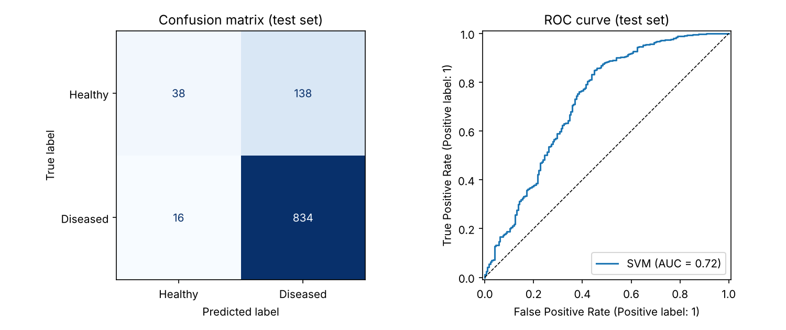
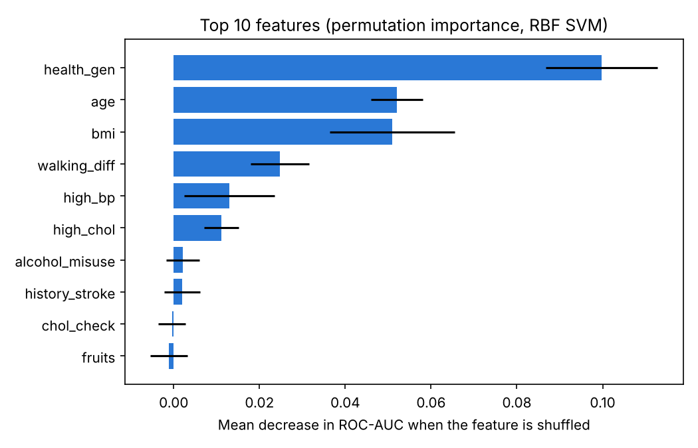
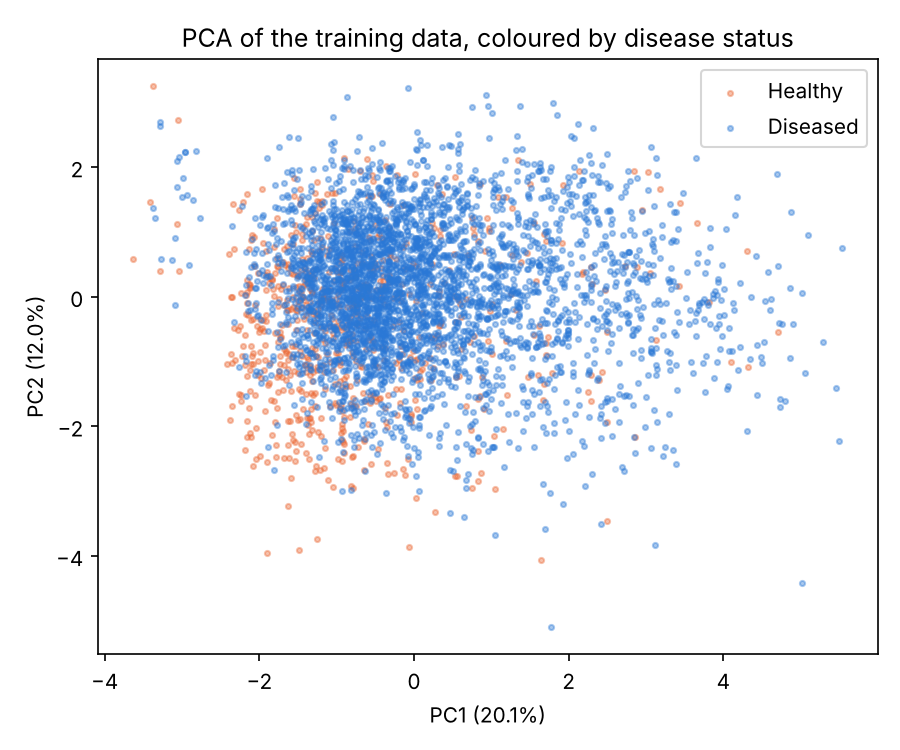

# Predicting metabolic disorder from health survey data

A machine learning coursework project from university.

The task: take a dataset of patients described by 17 lifestyle and health features, and build a
classifier that separates patients with a metabolic disorder from healthy individuals. It was a
group task in which each member analysed a different dataset; this is my analysis of
`patients_04.csv`.

Everything is in one notebook:
[`notebooks/metabolic_disorder_classification.ipynb`](notebooks/metabolic_disorder_classification.ipynb)

## Data

5,129 patients, 17 features, one target column (`dissease`, True / False).

| Type | Features |
|---|---|
| Demographics | age, gender, BMI |
| Medical history | high blood pressure, high cholesterol, cholesterol check, stroke, heart disease |
| Lifestyle | smoking, alcohol, physical activity, fruit, vegetables |
| Health status | general health rating, days of poor mental health, days of poor physical health, difficulty walking |

Feature definitions are in [`data/Feature_Data_Description.txt`](data/Feature_Data_Description.txt).

Two things about the data shaped the whole analysis:

- **Class imbalance.** 83% of patients have the disease, 17% are healthy.
- **Missing values.** Smoking history is missing for 30% of patients, alcohol for 20% and activity for 18%.

## What I did

1. **Exploratory analysis**: feature types, class balance, missing values, outliers, correlation.
2. **Split**: 80 / 20 train / test, stratified by disease status.
3. **Missing data**: median for numeric features and most frequent category for categorical ones, fitted inside a scikit-learn pipeline so that nothing leaks from the test data.
4. **Unsupervised analysis**: PCA and k-means to look for patient sub-groups.
5. **Supervised models**: logistic regression, k-nearest neighbours, decision tree, random forest and SVM, compared by 5-fold cross-validation.
6. **Evaluation** of the selected model on the held-out test set, with an overfitting check.
7. **Interpretation**: permutation feature importance, its stability across folds, and retraining without the most important feature.
8. **Threshold and error analysis**: which patients the model gets wrong.

## Results

### Model comparison (5-fold cross-validation on the training set)

| Model | Accuracy | Precision | Recall | F1 | ROC-AUC |
|---|---|---|---|---|---|
| SVM (RBF) | 0.859 | 0.863 | 0.987 | 0.921 | 0.729 |
| Random forest | 0.856 | 0.869 | 0.973 | 0.918 | 0.748 |
| k-nearest neighbours | 0.853 | 0.861 | 0.982 | 0.917 | 0.729 |
| Logistic regression | 0.851 | 0.865 | 0.972 | 0.915 | 0.781 |
| Decision tree | 0.751 | 0.860 | 0.836 | 0.848 | 0.589 |

I selected the SVM because it had the best F1 score.

### Final model on the test set (1,026 patients)

| Metric | Value |
|---|---|
| Accuracy | 0.85 |
| ROC-AUC | 0.72 |
| Recall, diseased | 0.98 |
| Recall, healthy | 0.22 |
| Balanced accuracy | 0.60 |
| Accuracy of always predicting "diseased" | 0.83 |



The model finds almost every diseased patient but recognises only about one in five healthy people.
Its accuracy is barely above the 83% you get by calling everyone diseased, so ROC-AUC and balanced
accuracy describe it more fairly than accuracy does. Training (0.87) and test (0.85) accuracy are
close and the cross-validated ROC-AUC is stable (0.73 ± 0.02), so the model is not overfitting.

### Which features matter?



General health rating is the most important feature, followed by age and BMI. The same three lead
in every cross-validation fold. Lifestyle features add almost nothing.

Retraining without general health:

| | Accuracy | F1 | ROC-AUC |
|---|---|---|---|
| All features | 0.850 | 0.915 | 0.723 |
| Without general health | 0.848 | 0.915 | 0.698 |

The ROC-AUC drops by 0.025 while accuracy and F1 hardly change, and the two models agree on 98.6%
of patients. Both predict "diseased" for almost everyone, so the threshold-based metrics hide the
loss that ROC-AUC shows.

### Patient sub-groups



Healthy and diseased patients overlap heavily in PCA space. K-means finds no sharply separated
clusters (best silhouette 0.23 at k = 3), but the three groups are interpretable: a large group in
fairly good health (81% diseased), a group in poor physical and mental health (91% diseased), and a
small group of heavy drinkers (61% diseased).

## What I would do differently

- **Choose the model differently.** Logistic regression had a clearly higher ROC-AUC than the SVM (0.78 vs 0.73). F1 for the majority class was the wrong thing to optimise on imbalanced data.
- **Deal with the imbalance** using class weights or resampling, so that healthy patients are recognised better.
- **Clean implausible values.** 36 patients have a BMI of 0 and 385 report more than 30 "days in the past 30 days" of poor physical health. I left them in; they should be treated as missing.
- **Tune the SVM.** I used the default C and gamma.
- **Handle missing smoking data better**, for example with a missing-value indicator.

## Running it

```bash
pip install -r requirements.txt
jupyter notebook notebooks/metabolic_disorder_classification.ipynb
```

The notebook reads `data/patients_04.csv` and writes its figures to `figures/`.

## Repository layout

```
notebooks/metabolic_disorder_classification.ipynb   the full analysis, with outputs
data/patients_04.csv                                the dataset
data/Feature_Data_Description.txt                   feature definitions
figures/                                            figures saved by the notebook
requirements.txt
```

## Author

Asha Jyothi Avanigadda, MSc Bioinformatics, University of Birmingham
